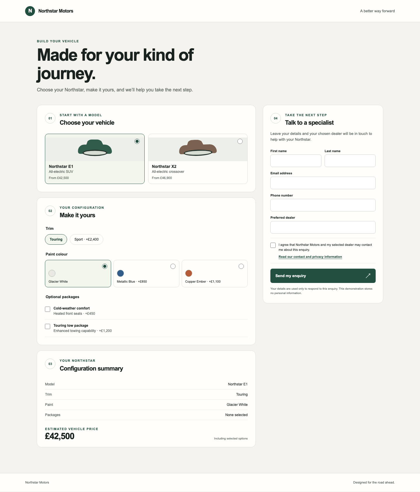
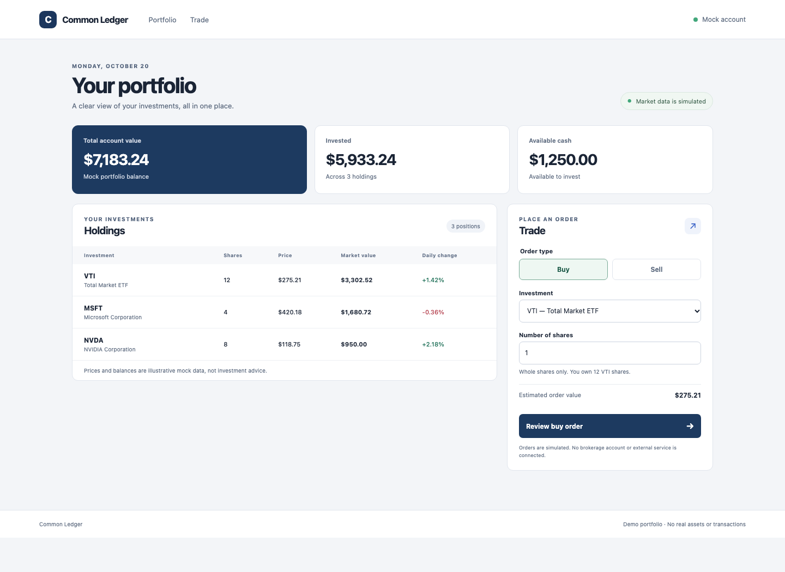
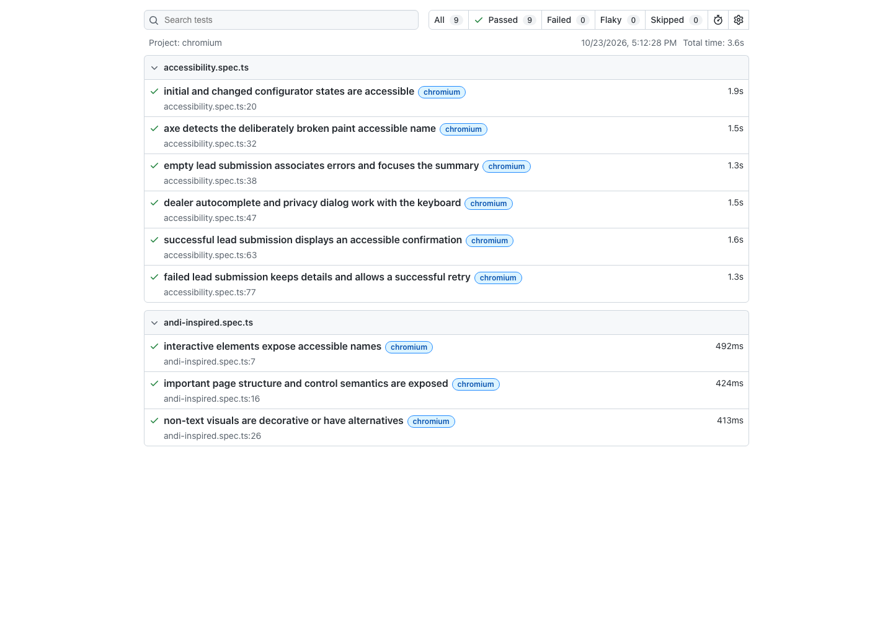
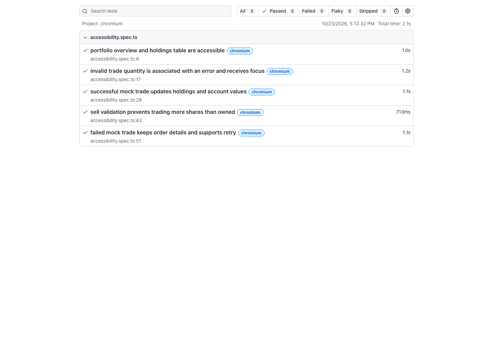
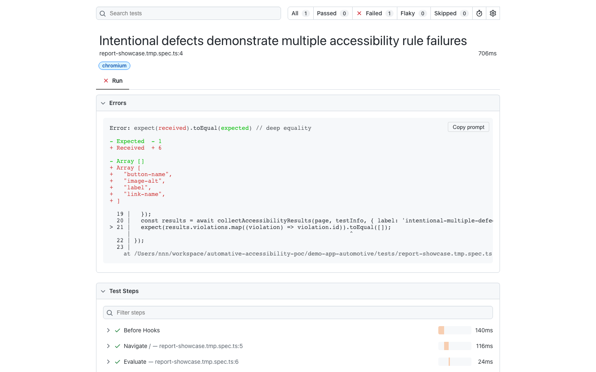

# Playwright Accessibility Framework and Demos

A reusable TypeScript/Playwright accessibility package, demonstrated by two independent mock applications: an automotive configurator and a stock portfolio. The framework combines axe-core scans with reusable assertions for accessible names, focus, form errors, live regions, combobox state, and responsive overflow.

All application data and service responses are synthetic. The demos do not connect to a real dealer, CRM, brokerage, or financial service.

## Screenshots

### Automotive configurator



### Stock portfolio



### Playwright test reports

The current screenshots show 10 passing automotive tests and 6 passing portfolio tests.





The following report is an intentional failure demonstration. A temporary test injected an unnamed button and link, an image without alternative text, and a form control without a label. These defects are not part of the normal passing test suites.



## Repository layout

```text
framework/playwright-accessibility/  Shared accessibility helpers
demo-app-automotive/                 Automotive configurator and tests
demo-app-stock-portfolio/            Stock portfolio and tests
screenshots/                         Demo and test-report images
```

Each demo owns its application behavior, synthetic data, service mocks, locators, and test states. The shared framework is consumed through the repository's npm workspace.

## Setup

Install dependencies and the Chromium browser:

```bash
npm install
npx playwright install chromium
```

On Linux, install any additional browser system dependencies required by your environment.

## Run the demos

Start the automotive configurator:

```bash
npm run dev:automotive
```

Start the stock portfolio:

```bash
npm run dev:stock-portfolio
```

## Build and test

Build the framework and both applications, then run the framework unit tests and both Playwright suites:

```bash
npm run build
npm test
```

Run the framework test suite directly:

```bash
npm test --workspace=@poc/playwright-accessibility
```

To run one app suite from a fresh checkout, build the shared package first:

```bash
npm run build --workspace=@poc/playwright-accessibility
npm test --workspace=automotive-accessibility-demo
```

Use `stock-portfolio-accessibility-demo` instead of `automotive-accessibility-demo` to run the portfolio tests.

## Use the framework

The framework's API, setup guidance, usage examples, reporting behavior, limitations, and integration notes are documented in [`framework/playwright-accessibility/README.md`](framework/playwright-accessibility/README.md).

At a glance, the package provides:

- axe-core scans using WCAG 2.0, 2.1, and 2.2 A/AA tags, with results attached to Playwright tests.
- Playwright helpers for accessible names and descriptions, focus containment/restoration, and validation-error associations.
- Assertions for live-region semantics, combobox relationships, and document-level horizontal overflow at selected viewports.
- A normalized finding format for application-owned reporting.

App tests choose meaningful states and expected behavior. Automated checks do not establish WCAG conformance or replace manual keyboard, screen-reader, zoom/reflow, and usability testing.

## License

This project is licensed under the [MIT License](LICENSE).
